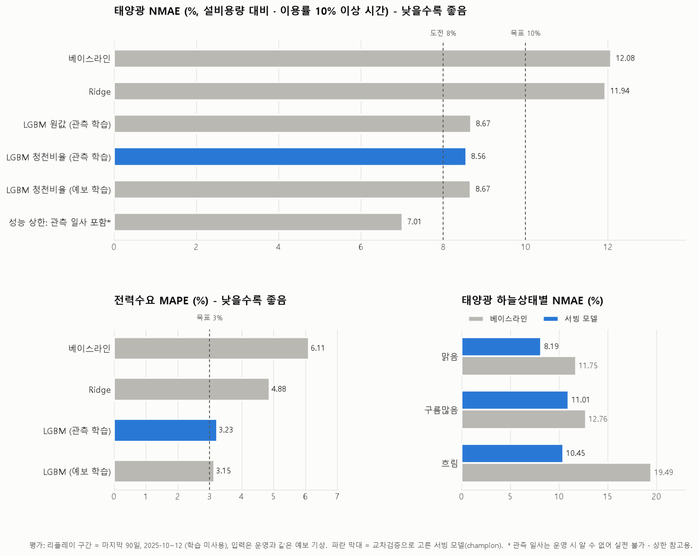

# 태양광 발전량 예측에서 "학습은 관측값, 운영은 예보값" 문제를 푼 방법

> 시리즈: 태양광 발전량·전력수요 예측 플랫폼 만들기 (1/3)
> 코드: https://github.com/orango0430/SolarForecast

## 들어가며

내일 시간별 태양광 발전량을 예측하는 모델을 만들었다. 대상은 한국남부발전 무릉리 태양광 발전소 1곳이고,
D일 17시에 나온 기상 예보로 D+1일 1시부터 24시까지 24개 값을 예측한다.

처음 계획은 단순했다. 과거 날씨와 과거 발전량을 모아서 LightGBM에 넣으면 끝. 그런데 데이터를 모으다가
이 구조에 근본적인 문제가 있다는 걸 알았다.

**학습할 때 쓰는 날씨와 실제로 예측할 때 쓰는 날씨가 다르다.**

## 문제: 모델이 보는 세상이 둘로 갈린다

과거 데이터로 학습할 때 손에 있는 날씨는 **관측값**이다. 그날 실제로 몇 도였고, 구름이 얼마나 꼈고,
햇빛(일사량)이 얼마나 들어왔는지.

하지만 내일을 예측할 때 손에 있는 건 **예보값**뿐이다. 내일의 관측값은 아직 존재하지 않는다.

이게 왜 문제냐면:

1. **예보는 틀린다.** 관측으로 학습한 모델은 "입력이 정확하다"고 믿고 배운다. 운영에서 부정확한 예보가 들어오면
   학습 때 본 적 없는 오차가 섞인다.
2. **더 큰 문제: 가장 중요한 변수가 예보에 없다.** 태양광 발전량을 가장 잘 설명하는 변수는 당연히 **일사량**이다.
   그런데 기상청 단기예보에는 일사량 항목이 없다. 기온, 습도, 하늘상태, 강수형태, 강수확률, 풍속은 있지만 일사량은 없다.

관측 일사량을 넣어 학습하면 모델 성능은 아주 좋게 나온다. 하지만 그 모델은 운영에서 쓸 수 없다.
내일의 일사량을 모르니까.

## 먼저 잰 것: 일사량을 모르는 대가는 얼마인가

해결책을 고르기 전에 문제의 크기부터 쟀다. 같은 LightGBM으로 두 모델을 학습했다.

- **성능 상한 모델**: 관측 일사량 포함. 운영에서는 쓸 수 없고, "일사량을 알면 이 정도까지 된다"는 기준선
- **실전 모델**: 예보에 있는 변수만 사용

평가는 학습에 쓰지 않은 마지막 90일(2025-10~12)로 했고, 실전 모델에는 **운영과 똑같이 예보값을 넣었다.**
지표는 설비용량 대비 오차율(NMAE)이다. 전력거래소 재생에너지 발전량 예측제도와 같은 방식으로,
발전이 거의 없는 시간(이용률 10% 미만)은 빼고 계산했다.

| 모델 | NMAE |
|---|---|
| 베이스라인 (최근 같은 시각 평균) | 12.08% |
| 성능 상한 (관측 일사 포함, 운영 불가) | 7.01% |
| **실전 모델 (예보 가능 변수만)** | **8.56%** |

**일사량을 모르는 대가는 약 1.5%p였다.** 생각보다 작았는데, 그 이유가 아래 해결 방법들이다.



## 해결 1: 학습 피처를 예보에 있는 변수로 제한한다

가장 기본은 **운영 때 알 수 없는 값은 학습에도 쓰지 않는 것**이다. 관측 데이터에는 일사량, 일조시간, 지면온도 등
쓸 만한 변수가 많지만 전부 버리고, 단기예보에 있는 변수만 남겼다.

```python
SOLAR_FEATURES = [
    "hour", "doy_sin", "doy_cos",            # 시각, 계절
    "tmp", "reh", "sky", "pty", "wsd",       # 단기예보에 있는 변수만
    "elevation", "azimuth", "clearsky_ghi",  # 계산값 (해결 2)
]
```

강수확률(POP)도 예보에는 있지만, 학습에 쓸 과거 예보 자료에 이 항목이 없어서 뺐다. 학습과 운영에 같은 값이
들어갈 수 없는 변수는 넣지 않는 게 원칙이다.

## 해결 2: 일사량 대신 "맑은 날이었다면 들어왔을 햇빛"을 계산한다

일사량은 예보에 없지만, **구름이 하나도 없을 때의 이론 일사량(청천일사량)**은 날씨와 상관없이 계산할 수 있다.
위도·경도·시각만 알면 태양의 위치가 정해지고, 대기를 통과해 들어오는 햇빛의 양도 물리 모델로 구할 수 있다.

Python의 `pvlib`로 계산했다. 날씨와 무관한 계산값이라 **학습 때와 운영 때 값이 완전히 같다.**

```python
def solar_geometry(times, lat, lon):
    # hour-ending(13시 = 12~13시) 구간의 중앙 시각 기준으로 계산
    mid = pd.DatetimeIndex(times) - pd.Timedelta(minutes=30)
    loc = pvlib.location.Location(lat, lon, tz="Asia/Seoul")
    pos = loc.get_solarposition(mid.tz_localize("Asia/Seoul"))
    cs = loc.get_clearsky(mid.tz_localize("Asia/Seoul"), model="ineichen")
    return pos["apparent_elevation"], pos["azimuth"], cs["ghi"]
```

한 가지 주의할 점: 발전량 데이터의 "13시" 값은 12시~13시 1시간 동안의 발전량이다. 태양 위치를 13시 정각으로 계산하면
30분씩 어긋나서, 구간 중앙인 12시 30분으로 계산했다.

이렇게 하면 모델이 배워야 할 문제가 바뀐다. "발전량이 얼마인가"가 아니라
**"맑은 날 대비 몇 %나 나올까"**를 하늘상태·습도·강수 예보로부터 추정하는 문제가 된다.

## 해결 3: 예측 대상을 "맑은 날 대비 비율"로 바꾼다

해결 2를 한 걸음 더 밀어서, 예측 대상(타깃) 자체를 바꿔 봤다.

```python
# 발전량을 그대로 맞히는 대신, 청천일사량 기준 기대 발전량 대비 비율을 맞힌다
scale = capacity_kw * clearsky_ghi / 1000
y = generation_kwh / scale          # 학습 타깃
# 예측 후에는 다시 scale을 곱해 kWh로 되돌린다
```

발전량을 그대로 예측하면 모델은 "여름 정오엔 많고 겨울 아침엔 적다" 같은 계절·시간 패턴까지 배워야 한다.
비율로 바꾸면 그 패턴은 청천일사량이 이미 설명하므로, 모델은 **날씨 효과에만 집중**할 수 있다.

결과는 원값 8.67% → 비율 8.56%로, 효과는 있었지만 크지 않았다. LightGBM이 원래도 시각·계절 패턴을 잘 학습했기 때문으로
보인다. 그래도 교차검증 점수가 더 좋아서 이 방식을 서빙 모델로 골랐다.

## 해결 4: 관측 구름양을 예보의 하늘상태로 바꾼다

예보의 하늘상태(SKY)는 맑음(1)·구름많음(3)·흐림(4) 세 단계뿐이다. 반면 관측 전운량은 0~10의 숫자다.
관측값을 그대로 쓰면 학습 때는 세밀한 정보를, 운영 때는 거친 정보를 받게 된다.

그래서 관측 전운량을 기상청 기준 구간으로 잘라 **같은 척도**로 맞췄다.

```python
def sky_from_cloud(dc10):
    """관측 전운량(0~10) -> 단기예보 SKY 코드: 맑음 1(0~5), 구름많음 3(6~8), 흐림 4(9~10)"""
    return pd.cut(dc10, bins=[-1, 5, 8, 10], labels=[1, 3, 4]).astype(int)
```

정보를 일부러 버리는 셈이지만, 운영에서 받을 수 없는 해상도로 학습하는 것보다 낫다.

## 검증: 아예 과거 예보로 학습하면 더 나을까?

가장 근본적인 해결책은 **관측 대신 과거에 실제로 나왔던 예보로 학습**하는 것이다. 그러면 불일치 자체가 사라진다.
과거 하루 전 예보 자료를 구해서 같은 피처로 학습해 봤다.

| 학습 데이터 | NMAE (예보 입력으로 평가) |
|---|---|
| 관측 → 예보 체계로 변환 (해결 1~4) | **8.56%** |
| 과거 예보로 직접 학습 | 8.67% |

**거의 차이가 없었다.** 해결 1~4로 학습과 운영의 피처를 맞춰 두면, 관측으로 학습해도 예보로 학습한 것만큼
운영에서 버틴다는 뜻이다. 과거 예보 자료는 구하기 어렵고 기간도 짧은 경우가 많아서, 이 결과는 실용적으로 의미가 있었다.

## 정리

| 해결 방법 | 핵심 |
|---|---|
| 피처 제한 | 운영 때 모르는 값은 학습에도 쓰지 않는다 |
| 청천일사량 | 날씨와 무관한 물리 계산값으로 일사량을 대신한다 |
| 비율 타깃 | 계절·시간 패턴을 빼고 날씨 효과만 학습한다 |
| 하늘상태 변환 | 관측값을 예보와 같은 해상도로 맞춘다 |

일사량을 모르는 대가는 약 1.5%p였고, 최종 NMAE 8.56%로 1차 목표(10% 이하)는 달성했다.

## 한계와 남은 과제

- 학습용 과거 예보는 기상청 단기예보가 아니라 Open-Meteo의 하루 전 예보(JMA 모델)로 대신했다.
  발표 시각도 17시와 정확히 같지 않다.
- 발전소 설비용량(1,000kW)은 최대 출력에서 추정한 값이라, NMAE의 절대값은 실제 용량에 따라 달라질 수 있다.
- 2026년 1~2월로 다시 검증해 보니 겨울 성능이 10.4%로 떨어졌다. 겨울 오차의 원인 분석이 다음 과제다.

다음 글에서는 발전 실측이 1년에 한 번만 공개되는데 "매일 예측하고 채점하는" 운영을 어떻게 검증했는지,
리플레이 모드 설계를 다룬다.
